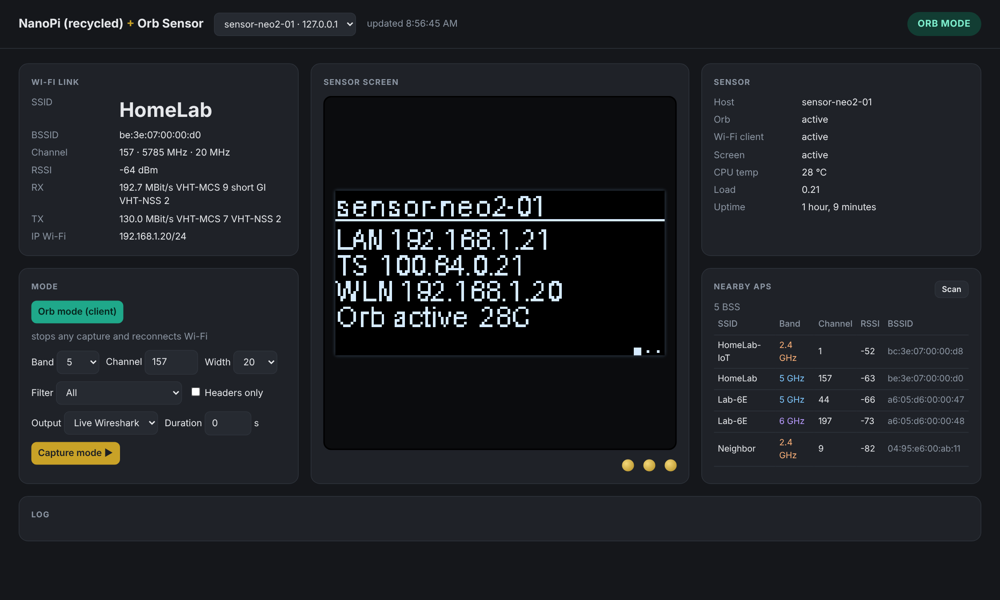
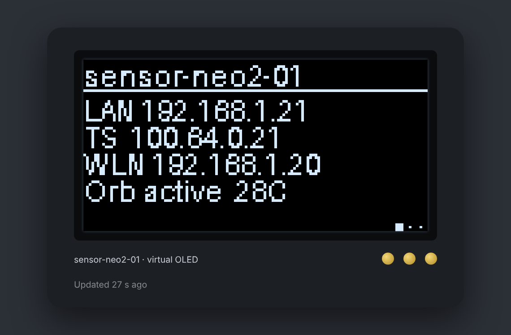

# Do Not Toss That Old WLAN Pi!

### NanoPi (recycled)

**Turn a retired NanoPi (ex-WLAN Pi, NEO2, NEO3…) into a 24/7 Orb network sensor that can also flip into a remote Wi-Fi packet sniffer — driven from your laptop, with an AI agent on top.**



That old WLAN Pi in your drawer still has a quad-core ARM, Gigabit Ethernet and USB. With a fresh Armbian image, a USB Wi-Fi adapter and the scripts in this repo, it becomes:

- **An [Orb](https://orb.net) sensor**: continuous responsiveness, reliability and speed scores *over Wi-Fi*, while Ethernet stays the management path.
- **A remote 802.11 capture probe** (`nanopi-recycled.sh`): one command or one click switches the adapter to monitor mode and streams frames live into Wireshark on your laptop. It goes back to Orb mode automatically when you stop.
- **A sensor you can ask questions**: a local MCP server (`server.py`) lets Claude (or any MCP client) run link checks, scans, pings, traceroutes and iperf3 across all your sensors.
- **A sensor with a face**: it brings the NanoHat OLED back to life and adds a *virtual* OLED, so boards without a screen get one too.

Nothing runs on the sensor except Orb, Tailscale and an optional status screen. All the logic lives on your laptop and talks to the sensors over SSH.

---

## What you need

| | |
|---|---|
| **Board** | NanoPi NEO2 / NEO2 Black (incl. ex-WLAN Pi), NanoPi NEO3. Other Armbian boards should work. |
| **OS** | Armbian minimal (Debian 13 "trixie") for your board, flashed to a *good* microSD card |
| **Wi-Fi** | A USB adapter with a mainline Linux driver. See [docs/adapters.md](docs/adapters.md). |
| **Laptop** | macOS (tested) or Linux, with Python 3.11+, SSH and Wireshark |
| **Accounts** | Orb (free), Tailscale (optional, for sensors off-site) |

## Quick start

```bash
git clone https://github.com/<you>/do-not-toss-that-old-wlanpi.git
cd do-not-toss-that-old-wlanpi

# 1. Laptop side: MCP server venv + sensors.json
bash install-mac.sh

# 2. Flash Armbian, finish the first-boot wizard, then from the laptop:
ssh-copy-id root@192.168.1.50
./provision-sensor.sh root@192.168.1.50 sensor-neo2-01
#    -> hostname, packages, Orb (with scan caps), Wi-Fi (metric 50),
#       regdomain, ARP-flux fix, Tailscale, status screen, sensors.json entry
#    The Wi-Fi password is prompted (hidden) and never stored in this repo.

# 3. Link the sensor in the Orb app, then open the dashboard:
./dashboard.sh            # http://127.0.0.1:8787
```

## The pieces

| File | Runs on | What it does |
|---|---|---|
| `provision-sensor.sh` | laptop | One-shot provisioning of a freshly flashed board (copies and runs `sensor-setup.sh`) |
| `sensor-setup.sh` | sensor | Idempotent setup: Orb, Wi-Fi, Tailscale, sysctls, adapter naming |
| `nanopi-recycled.sh` | laptop | Remote capture: `capture`, `status`, `restore` |
| `dashboard.py` / `dashboard.sh` | laptop | Local web UI: link, sensor health, nearby APs, live OLED, one-click capture |
| `server.py` | laptop | MCP server with 11 tools (see below) |
| `diag.sh` + `sensor-diag.sh` | laptop → sensor | Full health report, streamed over SSH (nothing copied), saved to `reports/` |
| `report2xlsx.py` | laptop | Turns a `diag.sh` report into a formatted workbook (Numbers / Excel); `diag.sh` calls it automatically |
| `backup-sensor.sh` | laptop | Config backup to `backups/` (mode 600, no Tailscale/Orb identity) |
| `install-oled.sh` | sensor | Status screen: `hw` (NanoHat OLED), `web` (virtual) or `both` |
| `prepare-sensor.sh` | sensor | Optional: least-privilege setup for a non-root SSH user |

### Remote capture

```bash
./nanopi-recycled.sh capture root@192.168.1.50 -b 5 -c 157            # live Wireshark
./nanopi-recycled.sh capture root@192.168.1.50 -b 6 -c 37 -w 160
./nanopi-recycled.sh capture root@192.168.1.50 -b 5 -c 157 -f "type mgt" -d 60 -o beacons.pcap
./nanopi-recycled.sh capture root@192.168.1.50 -b 2.4 -c 6 -s 256      # headers only
./nanopi-recycled.sh status  root@192.168.1.50
./nanopi-recycled.sh restore root@192.168.1.50                         # force Orb mode
```

Safety nets: the script refuses to start if the sensor has no other wired link (you would lose it). A remote trap restores client mode on disconnect, and a watchdog forces Orb mode back after `-m` seconds (default 30 min) no matter what. Frames stream over SSH; nothing touches the microSD.

### MCP tools

`list_sensors`, `sensor_health`, `net_status`, `wifi_link`, `wifi_scan`, `ping`, `trace_path`, `dns_lookup`, `iperf3_test`, `orb_status`, `compare_wifi`

Targets are validated, commands run over SSH with `BatchMode`, and nothing is installed on the sensor. `install-mac.sh` prints the snippet to add to `claude_desktop_config.json`.

Example prompts: *"Compare the Wi-Fi on all my sensors"*, *"Why is sensor-neo3-01 slow? Check the link, then run iperf3 to 100.64.0.5"*.

### Virtual OLED



The same 128×64 frames the NanoHat displays, served as PNG on the sensor (port 8088) and shown in the center of the dashboard.

## Architecture

```
 Laptop (macOS/Linux)                          NanoPi sensor (Armbian)
 ┌──────────────────────────────┐   SSH /     ┌─────────────────────────────┐
 │ Claude ── MCP ── server.py   │  Tailscale  │ Orb ── wlan0 (metric 50)    │
 │ Browser ── dashboard.py      │ ──────────▶ │ eth0 (mgmt, metric 100)     │
 │ Wireshark ◀─ nanopi-recycled │ ◀── pcap ── │ tcpdump (monitor mode)      │
 │ diag.sh / backup-sensor.sh   │             │ oled-status (hw / web)      │
 └──────────────────────────────┘             └─────────────────────────────┘
```

## Security notes

- `sensors.json`, `reports/`, `captures/` and `backups/` are git-ignored. Keep it that way: they hold IPs, scan results and Wi-Fi passwords.
- Captures can contain other people's traffic. Only capture networks you own or are authorized to test; use `-s 256` (headers only) when you can.
- The Wi-Fi PSK is read with a hidden prompt and passed base64-encoded over SSH. It lands in netplan on the sensor (root-only) and in backups (mode 600).
- Prefer a dedicated SSH key. If you would rather not use root, run `prepare-sensor.sh` (journal read access plus `sudo` for `iw` only).

## More

- [docs/adapters.md](docs/adapters.md): tested USB Wi-Fi adapters
- [docs/gotchas.md](docs/gotchas.md): everything that bit me, so it doesn't bite you

## Credits

Built on the shoulders of the [WLAN Pi](https://www.wlanpi.com) project and community, [Armbian](https://www.armbian.com), [Orb](https://orb.net), [Tailscale](https://tailscale.com), [luma.oled](https://github.com/rm-hull/luma.oled) and the [Model Context Protocol](https://modelcontextprotocol.io). Not affiliated with any of them.

Submitted as a talk proposal for #WLPC Phoenix 2027: *"Do Not Toss That Old WLAN Pi!"* (community vote Nov 15–30, 2026).

## License

MIT. See [LICENSE](LICENSE).
